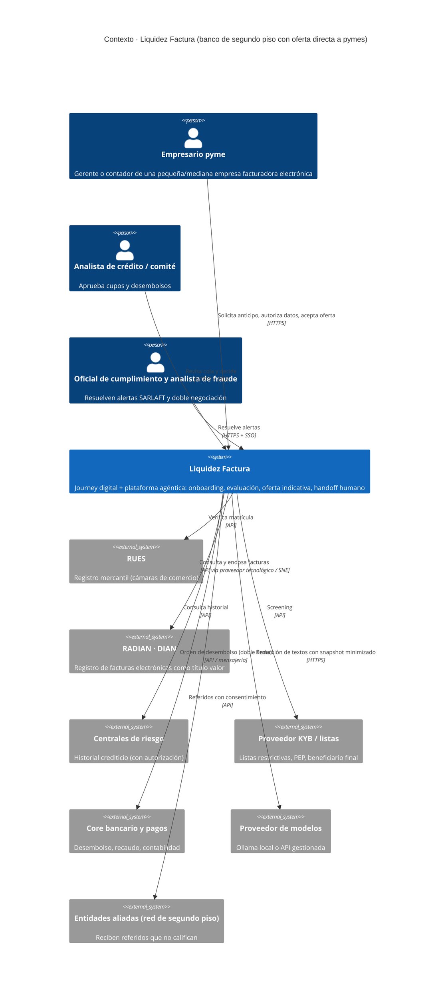
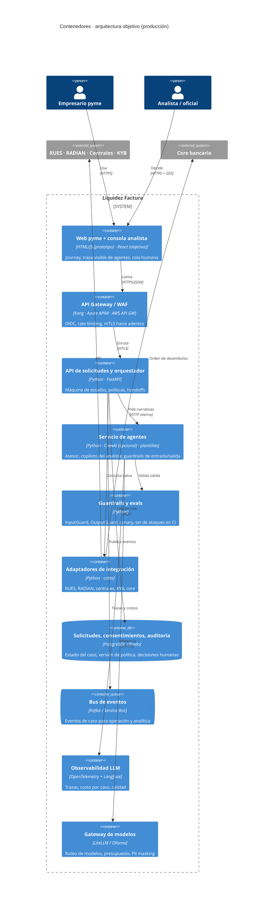
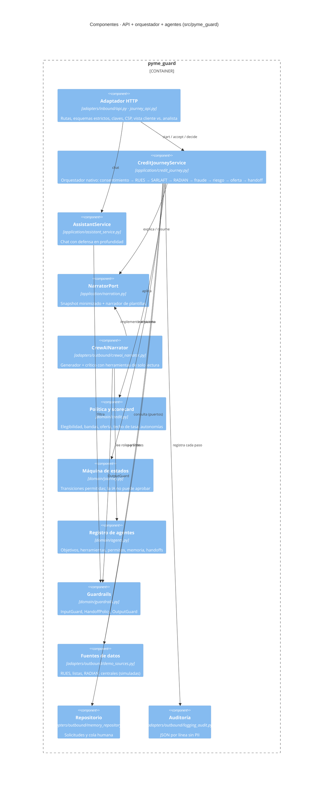
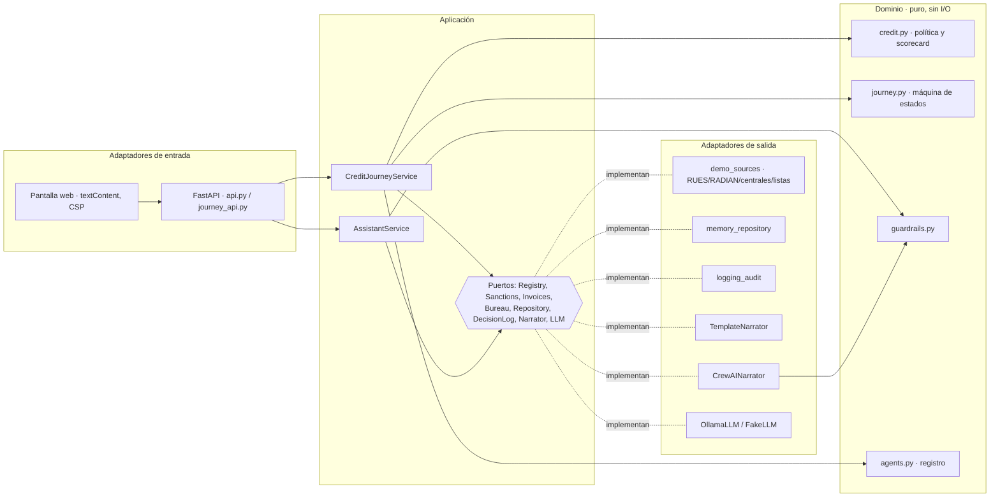
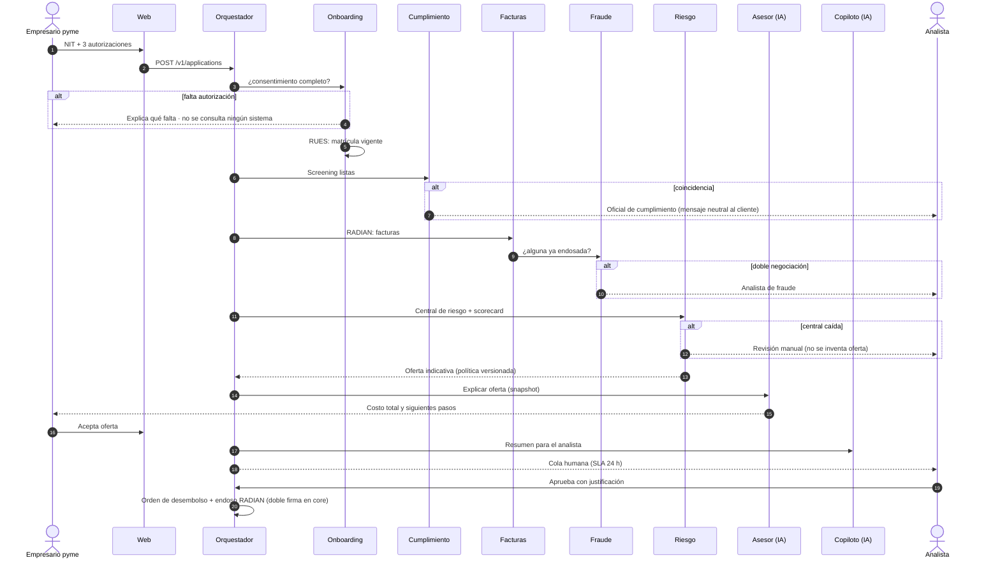
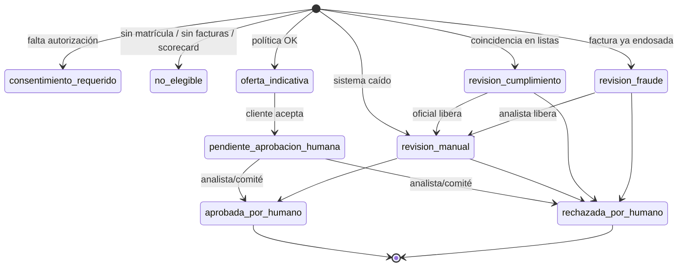
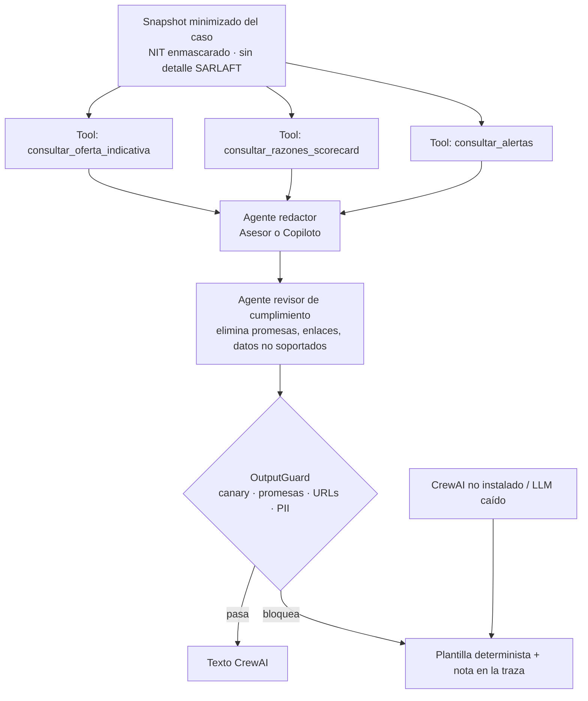
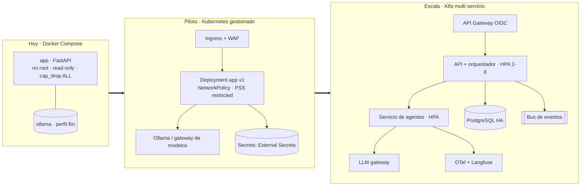

# Arquitectura · Liquidez Factura (banca pyme agéntica)

**Autor:** Jose Sanchez · **Versión:** 0.3.0 · **Fecha:** noviembre de 2026
**Alcance:** prueba técnica *AI Product Engineer · Banca Pyme agéntica* (caso ficticio).

Este documento describe la arquitectura con el modelo **C4** (contexto → contenedores → componentes → código), los agentes, los controles y cómo se despliega en contenedores. Todos los diagramas son Mermaid y se renderizan directamente en GitHub/GitLab.

> **Leyenda de alcance.** ✅ implementado en el prototipo · 🟡 simulado con datos ficticios · 🔜 roadmap (ver [ROADMAP.md](ROADMAP.md)).

---

## 1. Principios de diseño

| Principio | Cómo se materializa |
|---|---|
| **El LLM propone, la política dispone** | Elegibilidad, banda de riesgo, cupo y tasa salen de reglas deterministas y versionadas (`domain/credit.py`). La IA generativa solo redacta textos y pasa por el `OutputGuard`. |
| **Humano responsable en toda decisión crítica** | La máquina de estados (`domain/journey.py`) impide que el flujo automático fije `aprobada` o `rechazada`. Solo `human_decision()` con justificación obligatoria. |
| **Mínimo privilegio para agentes** | Registro único de agentes (`domain/agents.py`): los agentes con LLM solo leen un *snapshot* minimizado del caso; ninguno escribe en sistemas core. |
| **Fallar hacia una persona** | Si una central de riesgo o RADIAN no responde, el caso va a un analista (`revision_manual`). Nunca se inventa una oferta. |
| **Privacidad por diseño** | Sin consentimiento no se consulta ningún sistema; NIT enmascarado en snapshot y auditoría; PII enmascarada antes del LLM. |
| **Arquitectura hexagonal** | `adapters → application → domain`. Cambiar Ollama por otro modelo, o el orquestador por CrewAI, no toca el núcleo. |
| **Evals como compuerta** | `evals/run_evals.py` mide guardrails, journey e invariantes de gobierno y falla el CI si no se cumplen umbrales. |

---

## 2. C4 · Nivel 1: Contexto del sistema

**Por qué así:** el banco de segundo piso conserva su red de aliados (los casos no elegibles se refieren con consentimiento) y abre una relación directa en un producto *autoliquidable* y rico en datos (facturas aceptadas en RADIAN), donde el riesgo se apoya en la calidad del pagador.

---

## 3. C4 · Nivel 2: Contenedores (arquitectura objetivo)

**Hoy (v0.3):** web, API, orquestador, agentes y guardrails corren en **un solo contenedor** FastAPI (monolito modular hexagonal), con repositorio en memoria y fuentes simuladas. La separación en contenedores es una decisión de escalado, no un rediseño: los límites ya existen como puertos.

---

## 4. C4 · Nivel 3: Componentes del servicio (mapeados al código)

### Nivel 4 (código): hexagonal

---

## 5. Arquitectura agéntica

### 5.1 Agentes, objetivos, herramientas, permisos, memoria y handoffs

Fuente única: `src/pyme_guard/domain/agents.py` (también visible en la pestaña **4 · Agentes y permisos** y en `GET /v1/agents`).

| Agente | Objetivo | Herramientas / permisos | Informa | Recomienda | Ejecuta | Nunca | Memoria | Handoff |
|---|---|---|---|---|---|---|---|---|
| Orquestador | Llevar el caso por la máquina de estados | estado, cola, auditoría (escritura) | Estado | — | Transiciones permitidas, encolar | Aprobar, rechazar en definitiva, desembolsar | Estado del caso | Todas las personas |
| Onboarding y consentimiento | Explicar, capturar autorizaciones, verificar empresa | consentimientos (escritura), RUES (lectura) | Requisitos, uso de datos | — | Registrar consentimiento otorgado | Consultar sin autorización | Versión de autorización | Asesor pyme |
| Cumplimiento (SARLAFT/KYB) | Screening antes de cualquier oferta | listas (lectura) | — | Retener | — | Revelar coincidencia al cliente | Ninguna fuera del caso | Oficial de cumplimiento |
| Facturas (RADIAN) | Traer y filtrar facturas negociables | RADIAN (lectura) | Qué califica y por qué | Facturas a incluir | — | Endosar | Snapshot con CUFE | Analista de fraude |
| Guardián de fraude | Detectar doble negociación | RADIAN (lectura), reglas | — | Retener | — | Acusar, bloquear | Señales del caso | Analista de fraude |
| Riesgo | Scorecard explicable y oferta en política | centrales, política (lectura) | — | Banda, cupo, anticipo, tasa | — | Aprobar, superar techo | Resultado y versión de política | Analista / comité |
| Asesor (IA gen.) | Explicar costo y pasos en lenguaje claro | snapshot (lectura) | Costo total, pasos | Encaje con la necesidad | — | Prometer, fijar tasas, enlaces, PII | Sesión con PII enmascarada | Asesor pyme |
| Copiloto del analista (IA gen.) | Resumen verificable del caso | snapshot (lectura) | Resumen, alertas | Puntos a revisar | — | Decidir, ocultar alertas | Ninguna | Analista |

### 5.2 Qué decide la IA y qué decide una persona

| Decisión | IA | Persona |
|---|---|---|
| Explicar producto, requisitos y costos | ✅ informa | — |
| Filtrar facturas por política | ✅ recomienda (regla determinista) | Revisa en la cola |
| Banda de riesgo, cupo, tasa indicativa | ✅ recomienda (scorecard + política) | **Aprueba o ajusta** |
| Aprobar cupo / desembolso | ❌ | **Analista** (< umbral) o **comité** (≥ COP 800 M) |
| Coincidencia en listas | ❌ solo retiene | **Oficial de cumplimiento** |
| Doble negociación de factura | ❌ solo retiene | **Analista de fraude** |
| Liberar desembolso en el core | ❌ prepara la orden | **Operaciones con doble firma** |
| Cambiar la política o el scorecard | ❌ | **Comité de riesgo / gobierno de modelos** |

Autonomía futura (🔜, gate del mes 5 del roadmap): aprobación automática de operaciones pequeñas (p. ej. < COP 30 M, banda A, pagador AAA) **solo** si los evals y el piloto muestran pérdida y error dentro de umbral. El parámetro ya existe: `CreditPolicy.auto_approval_limit_cop` (hoy en 0).

### 5.3 Secuencia del journey (camino feliz + handoff)

### 5.4 Máquina de estados

Las flechas que llegan a `aprobada_por_humano` o `rechazada_por_humano` **solo** las puede disparar `human_decision()`; `set_pipeline_outcome()` las rechaza (probado en `tests/test_credit_journey.py`).

### 5.5 CrewAI: generador + crítico con degradación segura

- Activación: `PYME_NARRATOR=crewai`, `pip install -r requirements-crewai.txt` (o imagen con `INSTALL_CREWAI=true`) y un modelo (`PYME_CREWAI_MODEL=ollama/llama3.2` u otro proveedor LiteLLM).
- Probado con un módulo CrewAI falso (`tests/test_crewai_narrator.py`): cableado, herramientas de solo lectura, bloqueo de promesas y enlaces, y degradación.
- **Por qué CrewAI aquí y no en las decisiones:** las decisiones de crédito deben ser reproducibles y auditables; la generación de lenguaje es donde la IA aporta (claridad para el cliente, ahorro de tiempo del analista) con un riesgo acotado por el crítico y el guardrail.

### 5.6 Evolución agéntica (🔜)

| Patrón | Uso propuesto | Fase |
|---|---|---|
| **CrewAI Flows** con estado persistente y *human feedback* | Reemplazar el orquestador nativo cuando haya más productos (crédito de capital de trabajo, confirming) | Fase 3 |
| **MCP (Model Context Protocol)** | Exponer RADIAN, política y snapshot como servidores MCP con permisos por herramienta | Fase 2 |
| **A2A** | Interoperar con agentes de entidades aliadas (referidos) y de pagadores ancla (confirming) | Fase 3 |
| **LLM gateway** (LiteLLM) | Presupuesto por caso, ruteo modelo pequeño/grande, enmascarado central de PII | Fase 2 |
| **Clasificador de prompt injection** | Segunda capa tras los patrones (los evals declaran 2 ataques semánticos no bloqueados) | Fase 2 |
| **Observabilidad LLM** (OpenTelemetry + Langfuse) | Costo y calidad por caso, alertas de deriva | Fase 2 |

---

## 6. Controles

| Riesgo | Control | Dónde | Estado |
|---|---|---|---|
| **Privacidad / consentimiento** | Tres autorizaciones explícitas versionadas; sin ellas no hay consultas | `credit_journey.py`, `Consent` | ✅ |
| | NIT enmascarado en snapshot, API y auditoría; PII enmascarada antes del LLM | `narration.py`, `guardrails.py` | ✅ |
| | Retención, cifrado en reposo, derecho de revocación por API | PostgreSQL + KMS | 🔜 |
| **Explicabilidad** | Scorecard por reglas: cada punto y cada exclusión tiene una razón legible | `assess_risk`, `screen_invoices` | ✅ |
| | Oferta con costo total (descuento, comisión, E.A., neto) | `build_offer` | ✅ |
| **Fraude** | Detección de facturas ya endosadas en RADIAN → analista de fraude | `screen_invoices`, `fraude` | ✅ 🟡 |
| | Velocidad, concentración por pagador, verificación de cuenta destino | reglas + modelo | 🔜 |
| **Mensajes adversariales** | NFKC, invisibles, patrones ES/EN, payloads codificados, delimitadores, canary | `guardrails.py` | ✅ |
| | Crítico CrewAI + OutputGuard sobre todo texto generado | `crewai_narrator.py` | ✅ |
| **SARLAFT** | Screening antes de cualquier oferta; sin *tipping-off* | `cumplimiento` | ✅ 🟡 |
| **Calidad** | Evals offline como compuerta de CI (guardrails, journey, invariantes) | `evals/` | ✅ |
| | Muestreo humano de narrativas, *LLM-as-judge* con rúbrica, deriva | Langfuse | 🔜 |
| **Trazabilidad** | Traza por paso: agente, acción, sistemas, resultado, handoff; auditoría JSON sin PII | `journey.py`, `logging_audit.py` | ✅ |
| | Versión de política en cada oferta; justificación obligatoria en decisiones humanas | `Offer.policy_version`, `HumanDecision` | ✅ |
| **Disponibilidad** | Degradación a persona si una fuente cae; narrador degrada a plantilla | `_degrade`, `CrewAINarrator` | ✅ |
| **Seguridad de aplicación** | Claves en tiempo constante, esquemas estrictos, CSP, `textContent`, contenedor sin root y solo lectura | `api.py`, `Dockerfile`, compose | ✅ |
| | OIDC/SSO + RBAC por rol (analista ≠ oficial), WAF, rate limiting | Gateway | 🔜 |

---

## 7. Integración con sistemas y datos

| Sistema | Dato | Puerto | Adaptador hoy | Integración objetivo |
|---|---|---|---|---|
| RUES | Matrícula, antigüedad, actividad (CIIU) | `CompanyRegistryPort` | 🟡 `DemoDataset` | API RUES / proveedor de datos empresariales |
| RADIAN (DIAN) | Facturas, aceptación, endosos | `InvoiceRegistryPort` | 🟡 | Proveedor tecnológico o sistema de negociación electrónica habilitado |
| Centrales de riesgo | Puntaje, moras, endeudamiento | `CreditBureauPort` | 🟡 | API de la central, con autorización Ley 1266 |
| KYB / listas | ONU, OFAC, PEP, beneficiario final | `SanctionsPort` | 🟡 | Proveedor KYB del banco |
| Finanzas abiertas | Extractos y flujo de caja (con consentimiento) | 🔜 nuevo puerto | — | Estándares del Decreto 368 de 2026 cuando estén publicados |
| Core bancario | Desembolso, recaudo, contabilidad | 🔜 `DisbursementPort` | — | Orden con doble firma; eventos al bus |
| Modelos de IA | Narrativas | `NarratorPort`, `LLMPort` | ✅ Ollama / CrewAI / plantillas | Gateway de modelos con presupuesto |

---

## 8. Despliegue en contenedores

- `Dockerfile` multi-etapa, usuario 10001, `HEALTHCHECK`, `INSTALL_CREWAI` como *build arg*.
- `docker-compose.yml`: app en modo demo por defecto; `--profile llm` agrega Ollama sin exponer puertos.
- `deploy/k8s/`: base Kustomize (Namespace con Pod Security *restricted*, ConfigMap, Deployment endurecido, Service, NetworkPolicy). `hpa.yaml` queda fuera hasta tener PostgreSQL (el repositorio actual es en memoria: escalar réplicas hoy rompería el estado).
- CI (`.github/workflows/ci.yml`): ruff, mypy, pytest, **evals como compuerta**, pip-audit, build y escaneo Trivy.

El plan detallado por fases está en [ROADMAP.md](ROADMAP.md#3-roadmap-técnico-de-despliegue-en-contenedores).

---

## 9. Decisiones de arquitectura (ADR resumidos)

| # | Decisión | Alternativa descartada | Razón |
|---|---|---|---|
| 1 | Producto inicial: anticipo de facturas RADIAN | Crédito de libre inversión | Autoliquidable, datos verificables, riesgo en el pagador, ciclo corto para aprender |
| 2 | Decisiones por reglas versionadas; IA generativa solo para lenguaje | LLM que decide | Auditabilidad, explicabilidad y control del regulador |
| 3 | Orquestador nativo + CrewAI como adaptador opcional | Todo en CrewAI desde el día 1 | Reproducibilidad del flujo crítico; CrewAI aporta donde hay lenguaje |
| 4 | Monolito modular hexagonal | Microservicios desde el inicio | Equipo pequeño y piloto; los puertos permiten separar después |
| 5 | Ollama local por defecto | Solo API externa | Datos no salen del perímetro en el piloto; el gateway permite cambiar |
| 6 | Mensaje neutral en SARLAFT/fraude | Explicar el motivo | Evitar *tipping-off*; el detalle solo lo ve el oficial |

---

## 10. Limitaciones conocidas (declaradas)

- Datos y empresas **ficticios**; integraciones simuladas.
- Repositorio en memoria (se pierde al reiniciar; impide escalar réplicas).
- Claves estáticas de demo en lugar de SSO/RBAC.
- Los guardrails por patrones no cubren ataques semánticos (los evals reportan 2 de 30 no bloqueados; la arquitectura los contiene porque el LLM no puede decidir).
- El adaptador CrewAI se valida con un módulo falso; falta una prueba de integración con un modelo real en CI (requiere GPU/API).
