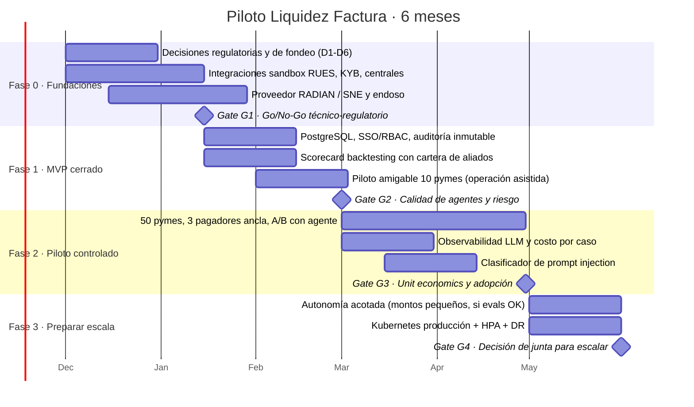

# Roadmap · Liquidez Factura

**Autor:** Jose Sanchez · noviembre de 2026

Tres horizontes conectados: **(1)** piloto de 6 meses con compuertas de decisión, **(2)** evolución del producto y de la arquitectura agéntica, **(3)** despliegue en contenedores hasta escalar.

---

## 1. Roadmap del piloto (6 meses) con compuertas de decisión

| Gate | Momento | Criterio para avanzar | Si no se cumple |
|---|---|---|---|
| **G1** | Mes 1-2 | Concepto jurídico favorable (primer piso y descuento de facturas), fondeo asignado, contratos de datos firmados, DPIA aprobada | Replantear producto o canal vía aliados |
| **G2** | Mes 3 | Evals ≥ umbrales en CI; 0 aprobaciones sin humano; backtesting del scorecard con Gini ≥ 0,35; NPS piloto ≥ 40 | Corregir y repetir piloto amigable |
| **G3** | Mes 5 | Conversión lead→solicitud ≥ 30%; saldo medio ≥ COP 110 M; mora > 30 d ≤ 3%; costo IA ≤ COP 2.000/solicitud | Ajustar precio/segmento; extender piloto 3 meses |
| **G4** | Mes 6 | Unit economics alineados con el escenario base del modelo; cumplimiento sin hallazgos críticos | No escalar; mantener piloto o cerrar |

### Dependencias críticas
1. Concepto de la SFC/área jurídica sobre la operación de primer piso y el endoso RADIAN.
2. Proveedor tecnológico o sistema de negociación electrónica habilitado por la DIAN.
3. Contratos con central de riesgo y proveedor KYB (incluye autorizaciones Ley 1266).
4. Fondeo y apetito de riesgo aprobados por junta.
5. Integración con el core (desembolso con doble firma, recaudo, contabilidad).

---

## 2. Indicadores (con meta del piloto)

| Dimensión | Indicador | Meta piloto |
|---|---|---|
| Producto | Tiempo solicitud → oferta indicativa | < 5 minutos |
| | Tiempo aceptación → decisión humana | < 24 horas (SLA analista) |
| Experiencia | NPS / CSAT del journey | NPS ≥ 40 · CSAT ≥ 4,3/5 |
| | Abandono en consentimiento | < 20% |
| Adopción | Conversión lead → solicitud completa | ≥ 30% (base del modelo 35%) |
| | Clientes activos que repiten en 90 días | ≥ 60% |
| Calidad de agentes | Tasa de bloqueo del set de ataques | ≥ 90% (hoy 93,3%) |
| | Falsos positivos de guardrails | ≤ 5% (hoy 0%) |
| | Narrativas descartadas por el OutputGuard | < 2% (si sube: revisar modelo/prompt) |
| | Precisión del resumen del copiloto (muestreo humano semanal) | ≥ 95% sin errores materiales |
| Costo | Costo de IA por solicitud | ≤ COP 2.000 |
| | Casos por analista al mes | ≥ 120 |
| Riesgo | Mora > 30 días sobre saldo | ≤ 3% |
| | Alertas de fraude confirmadas / generadas | Seguimiento (calibrar reglas) |
| Cumplimiento | Decisiones críticas con humano y justificación | 100% |
| | Consultas sin consentimiento | 0 |
| | Hallazgos de auditoría críticos | 0 |

---

## 3. Roadmap técnico de despliegue en contenedores

| Etapa | Qué | Entregables | Criterio de salida |
|---|---|---|---|
| **0 · Hoy (v0.3)** | Monolito modular en Docker Compose | `Dockerfile` multi-etapa sin root, `docker-compose.yml` (perfil `llm`), CI con evals | Demo reproducible con `docker compose up` |
| **1 · Persistencia** (mes 2) | PostgreSQL + migraciones; secretos fuera del código | Adaptador `PostgresApplicationRepository`, Alembic, External Secrets | Reinicio sin pérdida de casos |
| **2 · Kubernetes piloto** (mes 3) | Base `deploy/k8s/` en clúster gestionado (AKS/EKS/GKE) | Namespace *restricted*, NetworkPolicy, Ingress + WAF, OIDC en gateway | Pentest sin críticos |
| **3 · Observabilidad** (mes 3-4) | OpenTelemetry + Langfuse; dashboards de costo y calidad | Trazas por caso, alertas de deriva y de costo | Costo por caso medido |
| **4 · Escala horizontal** (mes 5) | `hpa.yaml` activo (2-8 réplicas), caché compartida, colas para integraciones | HPA, PodDisruptionBudget, Redis/colas | Prueba de carga 10x piloto |
| **5 · Servicio de agentes separado** (mes 6+) | Extraer agentes + gateway de modelos (LiteLLM) | Contenedor `agents`, presupuesto por caso, ruteo de modelos | Latencia p95 < 3 s en narrativas |
| **6 · Multi-producto** (año 2) | CrewAI Flows, MCP para herramientas, A2A con aliados | Crédito de capital de trabajo, confirming | Gate de junta por producto |

**Despliegue continuo:** imagen firmada (cosign) y fijada por *digest*, escaneo Trivy, *progressive delivery* (canary 10% → 50% → 100%) con *rollback* automático si cae la tasa de evals o sube el error.

---

## 4. Qué se construye primero y qué se deja para después

| Ahora (MVP) | Después |
|---|---|
| Anticipo de facturas RADIAN con recurso | Sin recurso, confirming con pagadores ancla |
| Scorecard por reglas explicable | Modelo estadístico con datos de finanzas abiertas (Decreto 368/2026) |
| Narrativas con plantilla + CrewAI opcional | CrewAI Flows para orquestación multi-producto |
| Aprobación 100% humana | Autonomía acotada en montos pequeños tras G3/G4 |
| Web responsive | App móvil, WhatsApp Business con los mismos guardrails |
| Referido a aliados (manual) | Integración A2A con entidades aliadas |

---

## 5. Decisiones que el banco debe resolver antes de escalar

1. **D1 · Habilitación regulatoria:** alcance de la licencia para primer piso y tratamiento del descuento de facturas (¿aplica techo de usura? hoy se usa como techo prudencial).
2. **D2 · Canal vs. aliados:** reglas para no competir con las entidades aliadas del segundo piso (segmentos, pagadores, referidos).
3. **D3 · Apetito de riesgo:** con o sin recurso, concentración por pagador, límite por cliente.
4. **D4 · Modelos de IA y datos:** ¿modelos locales u hospedados? residencia de datos, contratos con proveedores, política de retención.
5. **D5 · Gobierno de modelos:** quién aprueba cambios de política y scorecard; frecuencia de revalidación; dueño de los evals.
6. **D6 · Operación:** tamaño del equipo de analistas y SLA; atribuciones (analista vs. comité).
